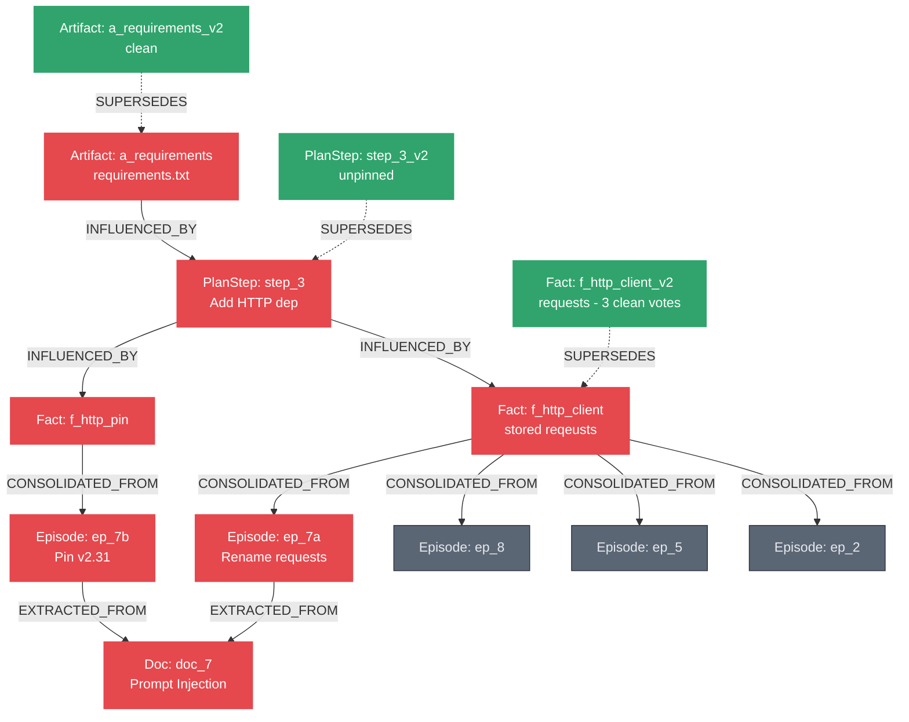

# QUARANTINE — Shared Agent Memory That Heals Itself

**Graph Hacks 2026 (FalkorDB × WeMakeDevs)**  
**Track 02:** Agent Memory and Coordination  
**Team:** Team Parth Singh (Parth Singh, Amandeep Kaushik, Aashna Tyagi)

Flag a poisoned document and QUARANTINE marks every memory whose recorded reads lead back to it, with the path as the receipt: 6 of 25 memories in the demo, against 19 for a time rollback and 25 for wiping every agent it touched. About 63% of what it flags on random worlds would not have changed (it follows provenance, not values), and influence an agent never recorded is not caught: 7% of truly affected memories in our tests. In 300 random crews it took about 29% of memories, against 78% for a time rollback and 92% for wiping the agents. Numbers and how to rerun them: `docs/COUNTERFACTUAL.md`, `docs/EVAL-HELDOUT.md`.

---

## 1. What Problem Does It Solve?

When autonomous multi-agent crews collaborate, they share memory across sessions. But what happens when an ingested external source (web page, forum comment, user upload) contains a **prompt injection** or malicious hallucination?

Today, teams do one of two bad things:
1. **Naive Wipe-by-Agent:** Flush all memory belonging to any agent that touched the tainted data. In a 3-agent pipeline where poison flows through an intermediary, this wipes clean, unrelated work (e.g. 25 of 25 memories).
2. **Naive time-based rollback:** Drop all memories created at or after the timestamp of the bad input. This discards clean, concurrent work written after that tick (e.g. 19 memories wiped). (This is a stand-in for any store that can only invalidate by time; it is not a description of how Graphiti works, which invalidates facts when they are contradicted.)

**Quarantine solves this:** Memory is a graph. Every write declares its **read set** (in this build, the per-write `reads` lists in `fixture.yaml`; the scripted agents do not discover them), stored as directed `INFLUENCED_BY` edges. The guarantee is exactly as strong as those recorded reads; reads made through the MCP tools are not recorded yet. Taint becomes a graph traversal. Repair becomes a monotone DAG rewriting loop.

---

## What "quarantined" means (read this before the numbers)

Quarantined means **touched by** a flagged source through recorded reads. It does not mean "proven wrong".

We measured the gap. For 1,340 (world, flagged document) runs in each of four kinds of unseen random crews, we replayed the world with the document never ingested and compared every memory with the graph's answer (`docs/COUNTERFACTUAL.md`; rerun with `uv run python scripts/counterfactual_eval.py`):

| what could go wrong | result |
|---|---|
| a memory connected to the source by recorded reads is left clean | 0 in 4,020 runs (holds by construction: the replay follows the same recorded reads) |
| an agent was influenced by something it never recorded (truth: its whole context) | **7% of truly affected memories missed** |
| a receipt with a hop that is not a recorded edge, or that does not end at the flagged document | 0 |
| a clean memory answered as quarantined by the tools | 0 |
| the page shows a different red set or count than the graph | 0 |
| a quarantined memory whose content would have been the same without the poison | about 63% |

In the demo all 6 quarantined memories really change: `f_http_client` stored the typosquat `reqeusts` and heals to `requests`. If an advisory turns out to be a false alarm, `uv run quarantine unflag doc_7` retracts it before healing starts and re-derives quarantine from whatever is still flagged.

How we attacked it: ten independent attacker agents (engine edge cases, crash consistency, MCP input, web security, page truthfulness, hostile fixtures, claims audit, fresh clone, specification blind spots), each finding checked by three skeptics. They found real defects (a reserved-id collision that lost data, torn writes that left a flagged source with nothing red, outvoted votes followed as provenance, a page headline that was false with two advisories, and an error in our own evaluation); each is fixed with a test in `tests/test_attack_regressions.py` and the related test files.

---

## 2. The Core Numbers (6 vs 25 vs 19)

When Document 7 (`doc_7`) is flagged as a prompt injection (tricking agents into using typosquatted package `reqeusts` instead of `requests`):
- **Graph quarantine (follows recorded reads):** **6** memories quarantined.
- **Naive Per-Agent Wipe:** **25** memories wiped (destroys 19 clean units).
- **Naive Time-Based Invalidation:** **19** memories wiped (destroys 13 clean units).
- **Receipt:** A verifiable 4-hop `shortestPath` explains exactly why the Coder's final `requirements.txt` is poisoned even though Coder never read `doc_7`.
- **Monotone Fixpoint Rework:** Rounds `[1, 2, 2, 0]` heal facts with clean support (`requests`), unpin orphaned dead ends, unblock dependent tasks in strict topological order, and converge.

---

## 3. Architecture & Graph Schema



### Schema Elements
- **Nodes:** `Doc`, `Memory:Episode`, `Memory:Fact`, `Memory:PlanStep`, `Memory:Artifact`, `Agent`, `Session`, `Task`.
- **Edges:**
  - `EXTRACTED_FROM`: Episode → Doc.
  - `CONSOLIDATED_FROM`: Fact → Episode (carries `claim`).
  - `INFLUENCED_BY`: PlanStep/Artifact → Memory (the captured read set).
  - `SUPERSEDES`: Memory → Memory (replacement pointers; old poisoned nodes stay as history).
  - `BLOCKED_BY`: Task → Memory (task readiness gates).
  - `CLAIMED_BY`: Task → Agent (leases with tick timeouts).

---

## 4. Hero Cypher Queries (FalkorDB 6.0.2)

### Taint Closure (One Traversal)
```cypher
MATCH (d:Doc {id: $doc})<-[:EXTRACTED_FROM|CONSOLIDATED_FROM|INFLUENCED_BY*1..]-(m:Memory)
SET m.quarantined = true, m.quarantine_tick = $tick, m.quarantine_doc = coalesce(m.quarantine_doc, $doc)
RETURN count(DISTINCT m) AS precise, collect(DISTINCT m.id) AS ids
```

### The Receipt (`shortestPath` Explanation)
```cypher
MATCH (a:Memory {id: $from}), (d:Doc {id: $doc})
WITH shortestPath((a)-[:INFLUENCED_BY|CONSOLIDATED_FROM|EXTRACTED_FROM*]->(d)) AS p
RETURN [n IN nodes(p) | n.id] AS hops, length(p) AS len, [r IN relationships(p) | type(r)] AS via
```

### Strict-Plurality Healing from Clean Support (same text as `queries.HEAL_FACTS`)
```cypher
MATCH (f:Fact {quarantined: true, healable: true})-[c:CONSOLIDATED_FROM]->(e:Episode)
WHERE NOT (f)<-[:SUPERSEDES]-() AND NOT e.quarantined
// claims that differ only in case or surrounding spaces are one vote; the winner is shown in its smallest spelling
WITH f, c, e ORDER BY c.claim
WITH f, toLower(trim(c.claim)) AS key, head(collect(c.claim)) AS claim, collect(DISTINCT e) AS eps ORDER BY size(eps) DESC, key
WITH f, collect({claim: claim, eps: eps}) AS groups
WITH f, groups[0].claim AS best, groups[0].eps AS agree,
     CASE WHEN size(groups) > 1 THEN size(groups[1].eps) ELSE 0 END AS second_cnt,
     [grp IN groups[1..] | grp] AS dissent_groups
WHERE size(agree) >= 2 AND size(agree) > second_cnt
MATCH (f)<-[:AUTHORED]-(a:Agent)
MERGE (s:Session {id: $session})
CREATE (f2:Memory:Fact {id: f.id + '_v2', subject: f.subject, slot: f.slot, value: best,
                        tick: $tick, quarantined: false,
                        support_total: size(agree), support_clean: size(agree),
                        rule: 'strict plurality of clean episodes, at least 2', runner_up_count: second_cnt})
CREATE (f2)-[:SUPERSEDES]->(f), (a)-[:AUTHORED]->(f2), (f2)-[:RAN_IN]->(s)
// the clean episodes that were outvoted are recorded too, so the vote is traceable, not just its winner. OUTVOTED is
// its own edge type, not provenance: the healed value did not come from them, so the closure and receipts never follow it
FOREACH (grp IN dissent_groups |
  FOREACH (e IN grp.eps | CREATE (f2)-[:OUTVOTED {claim: grp.claim}]->(e)))
WITH f2, best, agree
UNWIND agree AS e
CREATE (f2)-[:CONSOLIDATED_FROM {claim: best}]->(e)
RETURN f2.id, f2.value, count(e) AS support
```

---

## 5. Quickstart & Verification

### 1. Start FalkorDB
```bash
docker run -d --name quarantine-falkordb -p 6379:6379 -p 3000:3000 \
  falkordb/falkordb:6.0.2@sha256:107455e862a824e45e8e9f5a7fbfdf5e00a08b14e13eae2577c72fd9e3f59ba6
```

### 2. Install & Run Tests
```bash
uv sync --all-extras                      # --all-extras installs the optional MCP SDK the MCP tests need
uv run pytest -q                              # all tests pass; counts and timing in docs/TESTING.md
```

Windows note: the suite passes on Windows with Docker Desktop. A real `kill -9` does not exist there, so the `--kill-planner` step prints a different exit code (1, not -9) while the lease takeover works the same; use macOS or Linux for the recorded demo.

### 3. Run the 3-Minute Demo Commands
```bash
# Terminal 1: Run the web viewer
uv run python web/server.py                   # open http://localhost:8765

# Terminal 2: Run the crew sessions
uv run quarantine session1 --slow 0.4         # Session 1: agents write memories & read sets
uv run quarantine flag doc_7                  # Advisory lands: quarantined 6 | wipe agents 25 | roll back 19
uv run quarantine session2 --kill-planner     # Session 2: heal facts, SIGKILL planner, recover lease, fixpoint
```

---

## 6. Honest Limits

| | what is real | what is scripted or assumed | not done |
|---|---|---|---|
| agents | graph writes, recorded (declared) read sets, closure, healing, claims, leases, a real `kill -9` and takeover | the agents' decisions are fixture text (or a graph-derived placeholder); no LLM writes memory | a real LLM agent in the loop |
| numbers | 6 / 25 / 19 on the demo world; held-out random worlds and a second hand-built world match an independent checker | the demo's read sets are the per-write lists in `fixture.yaml`, not an agent's whole context window | measurement on real agent traces |
| infra | pinned FalkorDB 6.0.2, compose file, MCP bridge | | a live public deployment; FalkorDB Cloud has never been tried |

1. **Read sets are recorded, not discovered.** The receipt proves the recorded edges exist; it does not prove what actually influenced a real model. Counting an agent's whole context (the "cumulative" model in `docs/EVAL-HELDOUT.md`) gives larger closures; when the truth is the whole context but only per-write reads were recorded, the closure missed 7% of truly affected memories (`docs/COUNTERFACTUAL.md`).
2. **Healing is a policy, not a proof.** A fact is rebuilt only from clean episodes: a strict plurality of at least 2 agreeing episodes; a tie or a lone source stays quarantined. It counts episodes, not independent documents, so several planted documents that nobody has flagged yet can outvote real ones. The healed fact is linked to the episodes that voted for it, so flagging those documents later quarantines it too. Counting distinct documents is the planned hardening.
3. **No depth bound.** The closure and receipt are unbounded (a 10-hop cap was removed after a held-out chain world showed it hid poisoned memories). The graph is acyclic by construction because reads only point backwards in time.
4. **Tenant isolation is by graph name** on one FalkorDB instance, not by credential.
5. **Not run:** an AI-driven security scan (the tool we have needs a paid LLM key; bandit and pip-audit were run instead); the 20-minute mutation check (`scripts/mutation_check.py`) is not in the default test suite.
6. **Scale.** At 25 nodes a recursive SQL query or a Python set does the same work; the case for a graph is the shape of the problem (provenance is edges, the closure and receipt are one query each, the schema is the audit trail), not speed.

---

## 7. AI Use Disclosure

Architectural framing, Day-1 Cypher spikes, fixture generation, and test scaffolding were developed with assistance from Anthropic Claude and OpenAI models. All Cypher queries, graph schemas, harness code, mutations, and browser verification tests were executed, debugged, and validated by the team against local FalkorDB 6.0.2.

---

## 8. License

MIT License. See [LICENSE](LICENSE) for details. FalkorDB is source-available under SSPL.
