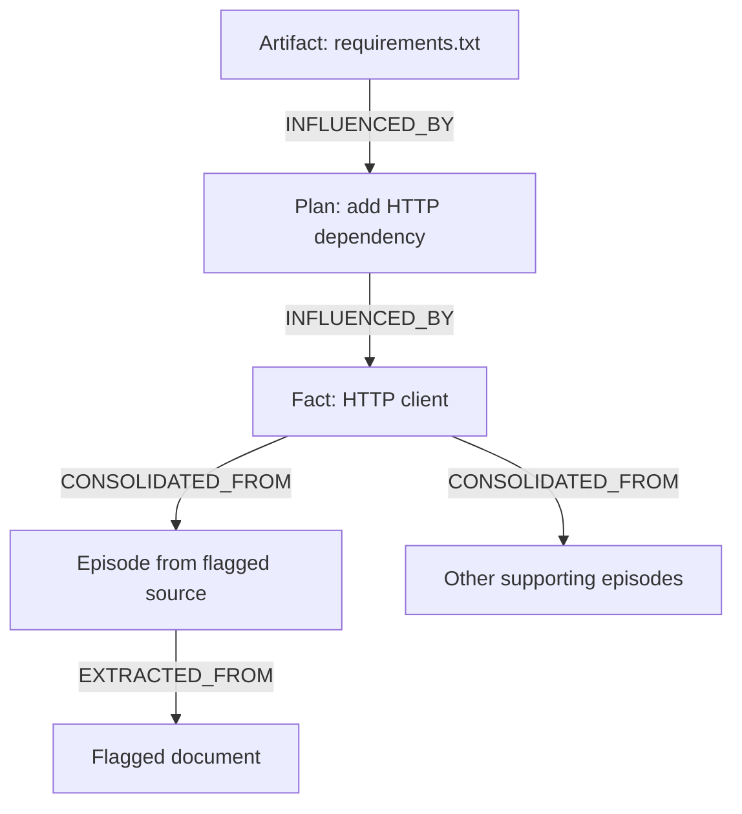

# QUARANTINE
## Trace affected agent memory. Rebuild only what needs rework.

QUARANTINE is a prototype for recovering shared agent memory after a source is flagged as untrustworthy. It records where memories came from, follows those connections across agents, and preserves unrelated work while affected items are quarantined and reworked.

**The current demo uses scripted research, planner, and coder actions.** The FalkorDB graph, dependency queries, task leases, and recovery writes are real. The project does not automatically detect prompt injections or demonstrate recovery for arbitrary LLM workflows.

Built for **Graph Hacks 2026 (FalkorDB × WeMakeDevs)**, Track 02: Agent Memory and Coordination.

**Team:** Parth Singh, Amandeep Kaushik, and Aashna Tyagi.

**In one paragraph.** Flag a poisoned document and QUARANTINE marks every memory whose recorded reads lead back to it, with the path as the receipt: 6 of 25 memories in the demo, against 19 for a time rollback and 25 for wiping every agent it touched. About 63% of what it flags on random worlds would not have changed (it follows provenance, not values), and influence an agent never recorded is not caught: 7% of truly affected memories in our tests. In 300 random crews it took about 29% of memories, against 78% for a time rollback and 92% for wiping the agents. Numbers and how to rerun them: [docs/COUNTERFACTUAL.md](docs/COUNTERFACTUAL.md), [docs/EVAL-HELDOUT.md](docs/EVAL-HELDOUT.md).

## Why we built it

A bad source can travel further than the agent that first reads it. A researcher may turn it into a fact, a planner may use that fact, and a coder may produce an artifact based on the plan.

Once the source is flagged, which work should be revisited?

Resetting every involved agent or discarding everything written after the source arrived can remove unrelated work. QUARANTINE explores a narrower approach: record dependencies as the work is created, then use those connections to identify what needs attention.

**A recorded dependency means an item may have been affected. It does not prove the item's contents are wrong.**

## What "quarantined" means (read this before the numbers)

Quarantined means **touched by** a flagged source through recorded reads. It does not mean "proven wrong".

We measured the gap. For 1,340 (world, flagged document) runs in each of four kinds of unseen random crews, we replayed the world with the document never ingested and compared every memory with the graph's answer ([docs/COUNTERFACTUAL.md](docs/COUNTERFACTUAL.md); rerun with `uv run python scripts/counterfactual_eval.py`):

| what could go wrong | result |
|---|---|
| a memory connected to the source by recorded reads is left clean | 0 in 4,020 runs (holds by construction: the replay follows the same recorded reads) |
| an agent was influenced by something it never recorded (truth: its whole context) | **7% of truly affected memories missed** |
| a receipt with a hop that is not a recorded edge, or that does not end at the flagged document | 0 |
| a clean memory answered as quarantined by the tools | 0 |
| the page shows a different red set or count than the graph | 0 |
| a quarantined memory whose content would have been the same without the poison | about 63% |

In the demo all 6 quarantined memories really change: `f_http_client` stored the typosquat `reqeusts` and heals to `requests`. If an advisory turns out to be a false alarm, `uv run quarantine unflag doc_7` retracts it before healing starts and re-derives quarantine from whatever is still flagged.

How we attacked it: ten independent attacker agents across nine areas (engine edge cases, crash consistency, MCP input, web security, page truthfulness, hostile fixtures, claims audit, fresh clone, specification blind spots), each finding checked by three skeptics. They found real defects (a reserved-id collision that lost data, torn writes that left a flagged source with nothing red, outvoted votes followed as provenance, a page headline that was false with two advisories, and an error in our own evaluation); each is fixed with a test in `tests/test_attack_regressions.py` and the related test files.

## What the demo shows

The fixture includes a document that instructs agents to use the misspelled package `reqeusts` instead of `requests`. That instruction reaches a `requirements.txt` artifact through intermediate memories, even though the coder never reads the original document.

When you flag `doc_7`, the demo:

1. Quarantines memories connected to that source through recorded dependencies (the flag and its closure are one atomic write).
2. Shows a path explaining how the source reaches an affected artifact.
3. Rebuilds eligible facts from remaining, unquarantined supporting episodes.
4. Reworks dependent plans and artifacts in dependency order.
5. Demonstrates recovery after a planner process is killed and its task lease expires.

Old memories remain in the graph. Replacements link back through `SUPERSEDES`, so the recovery history can be inspected. Outvoted clean episodes are recorded with a separate `OUTVOTED` edge that the closure and receipts do not follow.

### Results for the bundled fixture

| Strategy | Memories selected for quarantine or invalidation |
| --- | ---: |
| Follow recorded dependencies | 6 |
| Invalidate all memories authored by involved agents | 25 |
| Invalidate memories written at or after the affected episode | 19 |

These are results for **one constructed scenario**, not a general benchmark. The two broad invalidation strategies are comparison queries; the demo does not need to delete those memories to count them. The documented run also shows a four-hop explanation path, recovery rounds of `[1, 2, 2, 0]`, and 28 memory nodes after replacements are created. A second hand-built world (`fixtures/support-crew.yaml`, flag `kb_5`) gives 7 / 21 / 17.

The page is a light provenance ledger: five columns (sources, episodes, facts, plan steps, files), a chip per memory, a ribbon per recorded read. Red ink spreads from the flagged source, the receipt path is a yellow highlighter stroke, and the two wipe policies hatch the clean chips they would destroy.

## Run it locally

You need Git, Python 3.12 or later, [uv](https://docs.astral.sh/uv/), and a running Docker installation. No LLM API key is required for the scripted demo.

### Get the code

```bash
git clone https://github.com/Ps23102004/graphhacks-quarantine.git
cd graphhacks-quarantine
uv sync --all-extras                      # --all-extras installs the optional MCP SDK the MCP tests need
```

### Start FalkorDB

The project uses this pinned FalkorDB 6.0.2 image:

```bash
docker run -d --name quarantine-falkordb \
  -p 127.0.0.1:6379:6379 -p 127.0.0.1:3000:3000 \
  falkordb/falkordb:6.0.2@sha256:107455e862a824e45e8e9f5a7fbfdf5e00a08b14e13eae2577c72fd9e3f59ba6
```

If you already created this container, start it with `docker start quarantine-falkordb`. The default database connection is `localhost:6379`; `FALKORDB_HOST` and `FALKORDB_PORT` override it.

### Open the viewer

In one terminal:

```bash
uv run python web/server.py
```

Open [localhost:8765](http://localhost:8765).

### Run the scenario

In a second terminal, from the repository directory:

```bash
uv run quarantine session1 --slow 0.4
uv run quarantine flag doc_7
uv run quarantine session2 --kill-planner
uv run quarantine status
```

**Running `session1` resets the selected graph** before loading the fixture. The default graph is named `quarantine`; use a dedicated demo database. CLI commands accept `--graph NAME` if you need a different graph.

After flagging, expect `quarantined 6 | wipe agents 25 | roll back 19`. Session 2 prints the recovery steps and lease takeover. The viewer lets you inspect memories and their provenance. To retract a false alarm before healing starts: `uv run quarantine unflag doc_7`.

The `--kill-planner` option terminates a separate demo worker process. It demonstrates task recovery; the agents' decisions and replacement contents are still scripted. Windows note: a real `kill -9` does not exist there, so that step prints exit code 1 instead of -9 while the lease takeover works the same; use macOS or Linux for the recorded demo.

## How the graph works

Connections point from an output toward its inputs.



| Relationship | What it records |
| --- | --- |
| `EXTRACTED_FROM` | The document an episode came from |
| `CONSOLIDATED_FROM` | Episodes supporting a fact, with a claim on each edge |
| `INFLUENCED_BY` | Explicit memory inputs recorded for a plan or artifact |
| `SUPERSEDES` | A replacement memory and the older memory it replaces |
| `OUTVOTED` | A clean episode that lost a heal vote (recorded for traceability, not followed as provenance) |
| `BLOCKED_BY` | A dependency that must be resolved before a rework task proceeds |
| `CLAIMED_BY` | The agent holding a task lease and its expiry |

Nodes represent documents, memory episodes, facts, plan steps, artifacts, agents, sessions, and tasks.

### Find affected memories

This query follows recorded dependencies back to a flagged document and marks connected memories (the real statement, `queries.FLAG_AND_CLOSE`, runs it in the same write as the flag):

```cypher
MATCH (d:Doc {id: $doc})<-[:EXTRACTED_FROM|CONSOLIDATED_FROM|INFLUENCED_BY*1..]-(m:Memory)
SET m.quarantined = true, m.quarantine_tick = $tick, m.quarantine_doc = coalesce(m.quarantine_doc, $doc)
RETURN count(DISTINCT m) AS precise, collect(DISTINCT m.id) AS ids
```

### Explain an affected artifact

```cypher
MATCH (a:Memory {id: $from}), (d:Doc {id: $doc})
WITH shortestPath((a)-[:INFLUENCED_BY|CONSOLIDATED_FROM|EXTRACTED_FROM*]->(d)) AS p
RETURN [n IN nodes(p) | n.id] AS hops,
       length(p) AS len,
       [r IN relationships(p) | type(r)] AS via
```

### Rebuild a fact from clean support (same text as `queries.HEAL_FACTS`)

```cypher
MATCH (f:Fact {quarantined: true, healable: true})-[c:CONSOLIDATED_FROM]->(e:Episode)
WHERE NOT (f)<-[:SUPERSEDES]-() AND NOT e.quarantined
// claims that differ only in case or surrounding spaces are one vote; the winner is shown in its smallest spelling
WITH f, c, e ORDER BY c.claim
WITH f, toLower(trim(c.claim)) AS key, head(collect(c.claim)) AS claim, collect(DISTINCT e) AS eps ORDER BY size(eps) DESC, key
WITH f, collect({claim: claim, eps: eps}) AS groups
WITH f, groups[0].claim AS best, groups[0].eps AS agree,
     CASE WHEN size(groups) > 1 THEN size(groups[1].eps) ELSE 0 END AS second_cnt,
     [grp IN groups[1..] | grp] AS dissent_groups
WHERE size(agree) >= 2 AND size(agree) > second_cnt
MATCH (f)<-[:AUTHORED]-(a:Agent)
MERGE (s:Session {id: $session})
CREATE (f2:Memory:Fact {id: f.id + '_v2', subject: f.subject, slot: f.slot, value: best,
                        tick: $tick, quarantined: false,
                        support_total: size(agree), support_clean: size(agree),
                        rule: 'strict plurality of clean episodes, at least 2', runner_up_count: second_cnt})
CREATE (f2)-[:SUPERSEDES]->(f), (a)-[:AUTHORED]->(f2), (f2)-[:RAN_IN]->(s)
// the clean episodes that were outvoted are recorded too, so the vote is traceable, not just its winner. OUTVOTED is
// its own edge type, not provenance: the healed value did not come from them, so the closure and receipts never follow it
FOREACH (grp IN dissent_groups |
  FOREACH (e IN grp.eps | CREATE (f2)-[:OUTVOTED {claim: grp.claim}]->(e)))
WITH f2, best, agree
UNWIND agree AS e
CREATE (f2)-[:CONSOLIDATED_FROM {claim: best}]->(e)
RETURN f2.id, f2.value, count(e) AS support
```

The other recovery queries live in [quarantine/queries.py](quarantine/queries.py).

### Rebuild and resume

A fact can be rebuilt when at least two unquarantined supporting episodes agree (claims are compared ignoring case and surrounding spaces) and that claim has more votes than any competing claim. A tie or insufficient support leaves the fact unresolved.

Tasks wait for dependencies marked as healable to receive replacements. The fixture specifies how to rework plans and artifacts, including how to omit an unsupported dependency. Replacement writes reject missing or quarantined inputs. Leases coordinate task ownership and allow takeover after expiry, and a restarted process resumes its own unfinished claim. After any crash, `flag`, `unflag` and `session2` first re-derive quarantine from the documents that are flagged, and `quarantine status` warns about anything half-written.

Here, **unquarantined means not marked as affected by the recorded flags**. It does not mean independently verified, accurate, or safe. Agreement between episodes is a recovery rule, not proof of truth.

## Connecting real agents

There is no turnkey integration for arbitrary agent frameworks in this version. Session 1 loads explicit inputs from [fixture.yaml](fixture.yaml); Session 2 uses scripted replacement text and read sets from that fixture. Reads made through the MCP tools are not recorded as read sets yet.

A real integration would need to:

- Record the source of retrieved material and the memory IDs supplied to each agent action.
- Route memory writes through a controlled interface that records those inputs.
- Prevent quarantined inputs from being reused, including in retained context and summaries.
- Re-run affected work using permitted inputs and validate the result.
- Handle external actions separately; changing a memory cannot undo an email or data disclosure.

Recording inputs establishes provenance. It does not reveal exactly which input caused an LLM to produce a particular statement.

### Optional MCP inspection

The MCP server exposes a fixed, read-only tool catalog (the agent never writes Cypher). Every answer is one of four shapes: path, memory, not in graph, unknown. A null, numeric, list or missing id gets `unknown`, which also says when an id names a node of another kind; only a call to a tool that does not exist is a protocol error. A receipt cites only a document that is flagged now; after a torn write it says so instead of guessing.

```bash
uv sync --all-extras
uv run python -m quarantine.mcp_server
```

Tools: `inspect_quarantined_memories`, `trace_provenance_receipt`, `why_connected`, `recall`, `blast_radius`, `get_recovery_status`. A command-line client: `uv run python scripts/mcp_inspect.py list`.

## Verification

With FalkorDB running:

```bash
git rev-parse HEAD
uv run pytest -q                                           # all tests pass; counts change, see docs/TESTING.md
scripts/validate.sh                                        # throwaway FalkorDB on :6390; expect "0 failed"
uv run python scripts/counterfactual_eval.py --worlds 20   # replay evaluation; see docs/COUNTERFACTUAL.md
```

Record the commit SHA alongside your results so another person can reproduce the same version. See [docs/VALIDATION.md](docs/VALIDATION.md) for recorded results and open items, [docs/TESTING.md](docs/TESTING.md) for testing details, and [docs/DEMO-SCRIPT.md](docs/DEMO-SCRIPT.md) for the walkthrough.

Not run: an AI-driven security scan (the tool we have needs a paid LLM key; bandit and pip-audit were run instead), and the 20-minute mutation check (`scripts/mutation_check.py`) is not in the default test suite.

## Limits to keep in mind

- **Flagging is external.** A person or another system must identify the suspicious source.
- **Tracking is only as complete as the recorded inputs.** Untracked context, summaries, or tool results can carry influence the graph cannot see. When the truth is an agent's whole context but only per-write reads were recorded, the closure missed 7% of truly affected memories.
- **Reading is not proof of contamination.** Dependency-based quarantine includes outputs that did not adopt the bad instruction (about 63% of flags on random worlds).
- **Healing counts episodes, not independent documents.** Several planted documents nobody has flagged yet can outvote real ones, and unflagged sources can still be wrong; agreeing episodes may share the same underlying source.
- **No depth bound.** The closure and receipt are unbounded (a 10-hop cap was removed after a held-out chain world showed it hid poisoned memories). The graph is acyclic by construction because reads only point backwards in time.
- **Recovery is scripted.** Repeated attacks, arbitrary LLM decisions, and production-scale workloads need further evaluation. At 25 nodes a recursive SQL query does the same work; the case for a graph is the shape of the problem (provenance is edges, the closure and receipt are one query each, the schema is the audit trail), not speed.
- **Concurrent runs.** Two `session2` processes started at the same moment can take each other's live lease (every run uses the session name `s2`); the lease protects the `--kill-planner` demo and restarts, not parallel runs. Healing is independent of the order advisories arrive: a rebuilt fact always votes over the original fact's full clean support (`tests/test_attack_regressions.py`).
- **Tenant isolation is by graph name** on one FalkorDB instance, not by credential.
- **External effects remain external.** Memory repair cannot reverse actions already taken outside the graph.

The next useful test is a real agent workflow with independently assessed contamination, compared against restarting that workflow from a trusted checkpoint.

## AI assistance

The team used Anthropic Claude and OpenAI models for architectural exploration, Cypher experiments, fixture generation, test scaffolding, attack and review passes, and documentation. The repository includes validation notes describing the team's execution and review of the implementation against FalkorDB 6.0.2.

## License

QUARANTINE's code is MIT-licensed. See [LICENSE](LICENSE) for the copyright notice and terms.

FalkorDB is a separate dependency licensed under SSPLv1 (source-available, not open source). Review its [licensing guidance](https://docs.falkordb.com/references/license) before distributing it or offering a hosted service. QUARANTINE's MIT license does not replace dependency license obligations.
