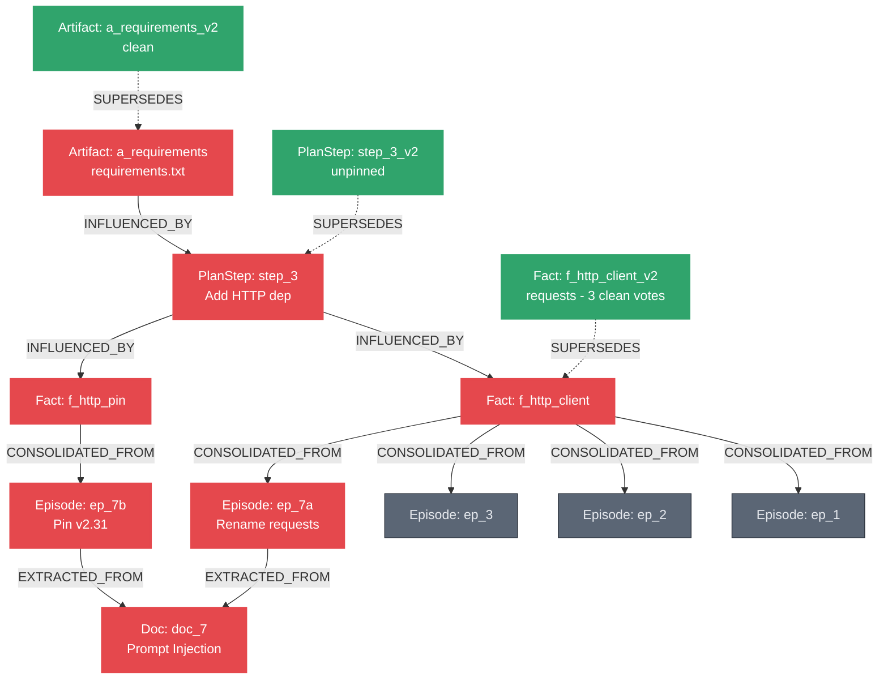

# QUARANTINE — Shared Agent Memory That Heals Itself

**Graph Hacks 2026 (FalkorDB × WeMakeDevs)**  
**Track 02:** Agent Memory and Coordination  
**Team:** Team Parth Singh (Parth Singh, Amandeep Kaushik, Aashna Tyagi)

---

## 1. What Problem Does It Solve?

When autonomous multi-agent crews collaborate, they share memory across sessions. But what happens when an ingested external source (web page, forum comment, user upload) contains a **prompt injection** or malicious hallucination?

Today, teams do one of two bad things:
1. **Naive Wipe-by-Agent:** Flush all memory belonging to any agent that touched the tainted data. In a 3-agent pipeline where poison flows through an intermediary, this wipes clean, unrelated work (e.g. 25 of 25 memories).
2. **Naive Invalidate-by-Time (Graphiti/Vector TTL):** Drop all memories created at or after the timestamp of the bad input. This blindly discards clean, concurrent work written after that tick (e.g. 19 memories wiped).

**Quarantine solves this:** Memory is a graph. Before every write, the harness captures the agent's explicit **read set** as directed `INFLUENCED_BY` edges. Taint becomes a graph traversal. Repair becomes a monotone DAG rewriting loop.

---

## 2. The Core Numbers (6 vs 25 vs 19)

When Document 7 (`doc_7`) is flagged as a prompt injection (tricking agents into using typosquatted package `reqeusts` instead of `requests`):
- **Graph-Precise Quarantine:** **6** memories quarantined.
- **Naive Per-Agent Wipe:** **25** memories wiped (destroys 19 clean units).
- **Naive Time-Based Invalidation:** **19** memories wiped (destroys 13 clean units).
- **Receipt:** A verifiable 4-hop `shortestPath` explains exactly why the Coder's final `requirements.txt` is poisoned even though Coder never read `doc_7`.
- **Monotone Fixpoint Rework:** Rounds `[1, 2, 2, 0]` heal facts with clean support (`requests`), unpin orphaned dead ends, unblock dependent tasks in strict topological order, and converge.

---

## 3. Architecture & Graph Schema



### Schema Elements
- **Nodes:** `Doc`, `Memory:Episode`, `Memory:Fact`, `Memory:PlanStep`, `Memory:Artifact`, `Agent`, `Session`, `Task`.
- **Edges:**
  - `EXTRACTED_FROM`: Episode → Doc.
  - `CONSOLIDATED_FROM`: Fact → Episode (carries `claim`).
  - `INFLUENCED_BY`: PlanStep/Artifact → Memory (the captured read set).
  - `SUPERSEDES`: Memory → Memory (replacement pointers; old poisoned nodes stay as history).
  - `BLOCKED_BY`: Task → Memory (task readiness gates).
  - `CLAIMED_BY`: Task → Agent (leases with tick timeouts).

---

## 4. Hero Cypher Queries (FalkorDB 6.0.2)

### Taint Closure (One Traversal)
```cypher
MATCH (d:Doc {id: $doc})<-[:EXTRACTED_FROM|CONSOLIDATED_FROM|INFLUENCED_BY*1..10]-(m:Memory)
SET m.quarantined = true, m.quarantine_tick = $tick
RETURN count(DISTINCT m) AS precise, collect(DISTINCT m.id) AS ids
```

### The Receipt (`shortestPath` Explanation)
```cypher
MATCH (a:Memory {id: $from}), (d:Doc {id: $doc})
WITH shortestPath((a)-[:INFLUENCED_BY|CONSOLIDATED_FROM|EXTRACTED_FROM*..10]->(d)) AS p
RETURN [n IN nodes(p) | n.id] AS hops, length(p) AS len, [r IN relationships(p) | type(r)] AS via
```

### Plurality Healing from Clean Support
```cypher
MATCH (f:Memory:Fact {quarantined: true})
WHERE f.healable = true
MATCH (f)-[r:CONSOLIDATED_FROM]->(e:Episode)
WHERE NOT e.quarantined = true
WITH f, r.claim AS val, count(e) AS cnt
ORDER BY cnt DESC
WITH f, collect(val)[0] AS win_val, collect(cnt)[0] AS win_cnt
MERGE (f2:Memory:Fact {id: f.id + '_v2'})
ON CREATE SET f2.value = win_val, f2.quarantined = false, f2.tick = $tick
MERGE (f2)-[:SUPERSEDES]->(f)
RETURN f2.id, f2.value, win_cnt
```

---

## 5. Quickstart & Verification

### 1. Start FalkorDB
```bash
docker run -d --name quarantine-falkordb -p 6379:6379 -p 3000:3000 \
  falkordb/falkordb:6.0.2@sha256:107455e862a824e45e8e9f5a7fbfdf5e00a08b14e13eae2577c72fd9e3f59ba6
```

### 2. Install & Run Tests
```bash
uv sync
uv run pytest -q                              # 52 passed in ~3s
```

### 3. Run the 3-Minute Demo Commands
```bash
# Terminal 1: Run the web viewer
uv run python web/server.py                   # open http://localhost:8765

# Terminal 2: Run the crew sessions
uv run quarantine session1 --slow 0.4         # Session 1: agents write memories & read sets
uv run quarantine flag doc_7                  # Advisory lands: precise 6 | per-agent 25 | time-based 19
uv run quarantine session2 --kill-planner     # Session 2: heal facts, SIGKILL planner, recover lease, fixpoint
```

---

## 6. Honest Limits

1. **Scripted Agent Traces:** Agents execute deterministic fixture actions; read sets and provenance captures are real FalkorDB edges. No non-deterministic LLM variance during the demo loop.
2. **Read-Set Granularity:** Edges track explicit inputs read prior to a write, not an unbounded dump of all prior chat history.
3. **Healing Method:** Fact healing uses topological voting over clean episodes (≥2 clean agreement required).
4. **Depth Bounds:** Variable-length reachability queries cap at depth 10.

---

## 7. AI Use Disclosure

Architectural framing, Day-1 Cypher spikes, fixture generation, and test scaffolding were developed with assistance from Anthropic Claude and OpenAI models. All Cypher queries, graph schemas, harness code, mutations, and browser verification tests were executed, debugged, and validated by the team against local FalkorDB 6.0.2.

---

## 8. License

MIT License. See [LICENSE](LICENSE) for details. FalkorDB is source-available under SSPL.
