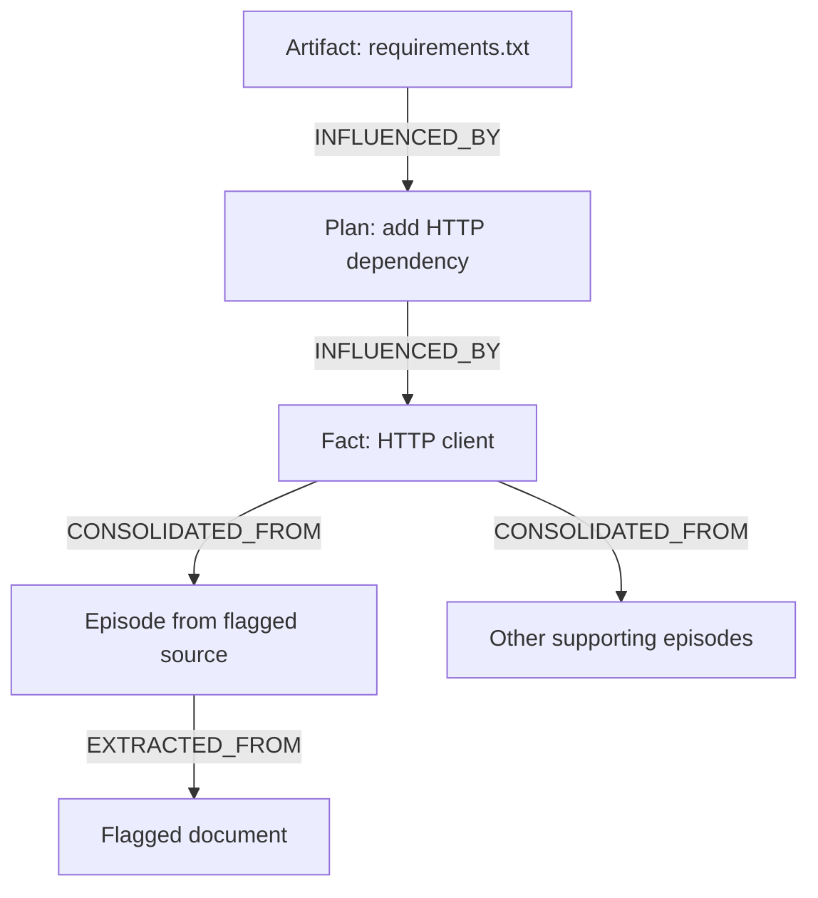

# QUARANTINE
## Trace affected agent memory. Rebuild only what needs rework.

QUARANTINE is a prototype for recovering shared agent memory after a source is flagged as untrustworthy. It records where memories came from, follows those connections across agents, and preserves unrelated work while affected items are quarantined and reworked.

**The current demo uses scripted research, planner, and coder actions.** The FalkorDB graph, dependency queries, task leases, and recovery writes are real. The project does not automatically detect prompt injections or demonstrate recovery for arbitrary LLM workflows.

Built for **Graph Hacks 2026 (FalkorDB × WeMakeDevs)**, Track 02: Agent Memory and Coordination.

**Team:** Parth Singh, Amandeep Kaushik, and Aashna Tyagi.

## Why we built it

A bad source can travel further than the agent that first reads it. A researcher may turn it into a fact, a planner may use that fact, and a coder may produce an artifact based on the plan.

Once the source is flagged, which work should be revisited?

Resetting every involved agent or discarding everything written after the source arrived can remove unrelated work. QUARANTINE explores a narrower approach: record dependencies as the work is created, then use those connections to identify what needs attention.

A recorded dependency means an item may have been affected. It does not prove the item's contents are wrong.

## What the demo shows

The fixture includes a document that instructs agents to use the misspelled package `reqeusts` instead of `requests`. That instruction reaches a `requirements.txt` artifact through intermediate memories, even though the coder never reads the original document.

When you flag `doc_7`, the demo:

1. Quarantines memories connected to that source through recorded dependencies.
2. Shows a path explaining how the source reaches an affected artifact.
3. Rebuilds eligible facts from remaining, unquarantined supporting episodes.
4. Reworks dependent plans and artifacts in dependency order.
5. Demonstrates recovery after a planner process is killed and its task lease expires.

Old memories remain in the graph. Replacements link back through `SUPERSEDES`, so the recovery history can be inspected.

### Results for the bundled fixture

| Strategy | Memories selected for quarantine or invalidation |
| --- | ---: |
| Follow recorded dependencies | 6 |
| Invalidate all memories authored by involved agents | 25 |
| Invalidate memories written at or after the affected episode | 19 |

These are results for **one constructed scenario**, not a general benchmark. The two broad invalidation strategies are comparison queries; the demo does not need to delete those memories to count them.

The documented run also shows a four-hop explanation path, recovery rounds of `[1, 2, 2, 0]`, and 28 memory nodes after replacements are created. These outcomes describe the fixture, not expected performance on other workloads.

## Run it locally

You need Git, Python 3.12 or later, [uv](https://docs.astral.sh/uv/), and a running Docker installation. No LLM API key is required for the scripted demo.

### Get the code

```bash
git clone https://github.com/Ps23102004/graphhacks-quarantine.git
cd graphhacks-quarantine
uv sync
```

### Start FalkorDB

The project uses this pinned FalkorDB 6.0.2 image:

```bash
docker run -d --name quarantine-falkordb \
  -p 127.0.0.1:6379:6379 -p 127.0.0.1:3000:3000 \
  falkordb/falkordb:6.0.2@sha256:107455e862a824e45e8e9f5a7fbfdf5e00a08b14e13eae2577c72fd9e3f59ba6
```

If you already created this container, start it with `docker start quarantine-falkordb`. The default database connection is `localhost:6379`; `FALKORDB_HOST` and `FALKORDB_PORT` override it.

### Open the viewer

In one terminal:

```bash
uv run python web/server.py
```

Open [localhost:8765](http://localhost:8765).

### Run the scenario

In a second terminal, from the repository directory:

```bash
uv run quarantine session1 --slow 0.4
uv run quarantine flag doc_7
uv run quarantine session2 --kill-planner
uv run quarantine status
```

**Running `session1` resets the selected graph** before loading the fixture. The default graph is named `quarantine`; use a dedicated demo database. CLI commands accept `--graph NAME` if you need a different graph.

After flagging, expect `precise 6 | per-agent 25 | time-based 19`. Session 2 prints the recovery steps and lease takeover. The viewer lets you inspect memories and their provenance.

The `--kill-planner` option terminates a separate demo worker process. It demonstrates task recovery; the agents' decisions and replacement contents are still scripted.

## How the graph works

Connections point from an output toward its inputs.



| Relationship | What it records |
| --- | --- |
| `EXTRACTED_FROM` | The document an episode came from |
| `CONSOLIDATED_FROM` | Episodes supporting a fact, with a claim on each edge |
| `INFLUENCED_BY` | Explicit memory inputs recorded for a plan or artifact |
| `SUPERSEDES` | A replacement memory and the older memory it replaces |
| `BLOCKED_BY` | A dependency that must be resolved before a rework task proceeds |
| `CLAIMED_BY` | The agent holding a task lease and its expiry |

Nodes represent documents, memory episodes, facts, plan steps, artifacts, agents, sessions, and tasks.

### Find affected memories

This query follows recorded dependencies back to a flagged document and marks connected memories:

```cypher
MATCH (d:Doc {id: $doc})<-[:EXTRACTED_FROM|CONSOLIDATED_FROM|INFLUENCED_BY*1..10]-(m:Memory)
SET m.quarantined = true, m.quarantine_tick = $tick
RETURN count(DISTINCT m) AS precise, collect(DISTINCT m.id) AS ids
```

### Explain an affected artifact

```cypher
MATCH (a:Memory {id: $from}), (d:Doc {id: $doc})
WITH shortestPath((a)-[:INFLUENCED_BY|CONSOLIDATED_FROM|EXTRACTED_FROM*..10]->(d)) AS p
RETURN [n IN nodes(p) | n.id] AS hops,
       length(p) AS len,
       [r IN relationships(p) | type(r)] AS via
```

The complete recovery queries live in [quarantine/queries.py](quarantine/queries.py).

### Rebuild and resume

A fact can be rebuilt when at least two unquarantined supporting episodes agree and that claim has more votes than any competing claim. A tie or insufficient support leaves the fact unresolved.

Tasks wait for dependencies marked as healable to receive replacements. The fixture specifies how to rework plans and artifacts, including how to omit an unsupported dependency. Replacement writes reject missing or quarantined inputs. Leases coordinate task ownership and allow takeover after expiry.

Here, **unquarantined means not marked as affected by the recorded flags**. It does not mean independently verified, accurate, or safe. Agreement between episodes is a recovery rule, not proof of truth.

## Connecting real agents

There is no turnkey integration for arbitrary agent frameworks in this version. Session 1 loads explicit inputs from [fixture.yaml](fixture.yaml); Session 2 uses scripted replacement text and read sets from that fixture.

A real integration would need to:

- Record the source of retrieved material and the memory IDs supplied to each agent action.
- Route memory writes through a controlled interface that records those inputs.
- Prevent quarantined inputs from being reused, including in retained context and summaries.
- Re-run affected work using permitted inputs and validate the result.
- Handle external actions separately; changing a memory cannot undo an email or data disclosure.

Recording inputs establishes provenance. It does not reveal exactly which input caused an LLM to produce a particular statement.

### Optional MCP inspection

The MCP server exposes read-only inspection tools, not a general agent memory read/write API:

```bash
uv sync --extra mcp
uv run python -m quarantine.mcp_server
```

Available tools:

- `inspect_quarantined_memories`
- `trace_provenance_receipt`
- `get_recovery_status`

## Verification

With FalkorDB running, run:

```bash
git rev-parse HEAD
uv run pytest -q
```

Record the commit SHA alongside your results so another person can reproduce the same version.

The team recorded 52 passing Python tests in its October 15, 2026 validation notes. Those notes also distinguish earlier fresh-clone and mutation checks from later working-tree and browser checks. They are historical evidence, not a claim that every check has been rerun against the current HEAD.

See [docs/VALIDATION.md](docs/VALIDATION.md) for recorded results and open items, [docs/TESTING.md](docs/TESTING.md) for testing details, and [docs/DEMO-SCRIPT.md](docs/DEMO-SCRIPT.md) for the walkthrough.

## Limits to keep in mind

- **Flagging is external.** A person or another system must identify the suspicious source.
- **Tracking is only as complete as the recorded inputs.** Untracked context, summaries, or tool results can carry influence the graph cannot see.
- **Reading is not proof of contamination.** Dependency-based quarantine can include outputs that did not adopt the bad instruction.
- **Unflagged sources can still be wrong.** Agreeing episodes may share the same underlying source.
- **Traversal is capped at 10 hops.** Longer dependency chains are outside the current queries' reach.
- **Recovery is scripted.** Repeated attacks, arbitrary LLM decisions, and production-scale workloads need further evaluation.
- **External effects remain external.** Memory repair cannot reverse actions already taken outside the graph.

The next useful test is a real agent workflow with independently assessed contamination, compared against restarting that workflow from a trusted checkpoint.

## AI assistance

The team used Anthropic Claude and OpenAI models for architectural exploration, Cypher experiments, fixture generation, test scaffolding, and documentation. The repository includes validation notes describing the team's execution and review of the implementation against FalkorDB 6.0.2.

## License

QUARANTINE's code is MIT-licensed. See [LICENSE](LICENSE) for the copyright notice and terms.

FalkorDB is a separate dependency licensed under SSPLv1. Review its [licensing guidance](https://docs.falkordb.com/references/license) before distributing it or offering a hosted service. QUARANTINE's MIT license does not replace dependency license obligations.
