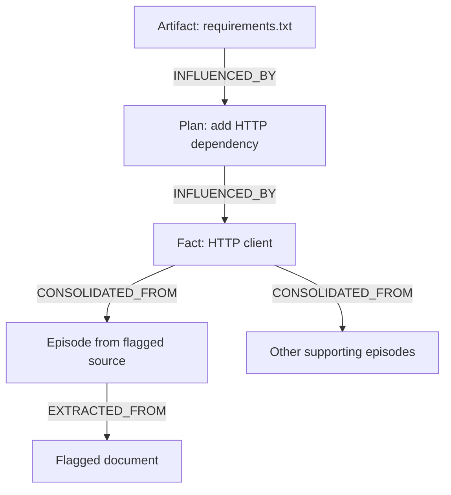

# QUARANTINE
## Flag one bad source. See what it reached. Keep the rest.

In the bundled demo, flagging one poisoned document quarantines 6 of 25 agent memories. Resetting every agent it touched would discard 25, and rolling back by time would discard 19.

QUARANTINE is a prototype for one job: a source in shared agent memory turns out to be bad, and you need to find and repair everything built on it. It follows recorded dependencies from the flagged source, quarantines the memories connected to it, and shows the path that connects each one.

We tested it on generated scenarios. When agents were influenced by things they never recorded, it missed about **7% of truly affected memories**. When agents recorded their reads, about **63% of quarantined memories would have kept the same content** without the flagged source. These numbers come from a 150-world run of synthetic worlds, repeated later on the same engine code (commit `c4de91d`) with identical results. They are not measurements on real agents. The model, counts and rerun command are in [docs/COUNTERFACTUAL.md](docs/COUNTERFACTUAL.md).

**The research, planner and coder agents in the demo are scripted.** The FalkorDB graph, dependency queries, task leases and recovery writes are real. The project does not detect prompt injections by itself, and it does not show recovery for arbitrary LLM workflows.

Built for **Graph Hacks 2026 (FalkorDB × WeMakeDevs)**, Track 02: Agent Memory and Coordination.

**Team:** Parth Singh, Amandeep Kaushik, and Aashna Tyagi.

**Timing:** The hackathon window is Oct 15, 00:01 IST to Oct 18, 23:59 IST. The earliest commit in this repository (`6c68104`) is dated 2026-10-14 23:03 EDT, which is Oct 15, 08:33 IST: inside the window. Everything after it is later. That first commit was written with AI assistance during the window; before it only notes and ideas existed.

**Demo video:** VIDEO_LINK_GOES_HERE

**20-second teaser:** [docs/media/launch-20s.mp4](docs/media/launch-20s.mp4) (real screenshots of the page with captions; assets in [docs/BRAG.md](docs/BRAG.md))

| Graph Hacks asks for | Where it is |
| --- | --- |
| Public repository | this repository |
| README with setup and the graph data model | [Run it locally](#run-it-locally), [How the graph works](#how-the-graph-works) |
| The Cypher the product depends on | [How the graph works](#how-the-graph-works) and [quarantine/queries.py](quarantine/queries.py) |
| Demo video | link above |
| Live deployment or complete local setup | complete local setup below (no live deployment) |
| Track | Track 02: Agent Memory and Coordination |
| AI-assistant disclosure | [AI assistance](#ai-assistance) |

## Why we built it

A bad source can travel further than the agent that first reads it. A researcher turns it into a fact, a planner uses the fact, and a coder writes a file from the plan. When the source is flagged, someone has to decide which of that work to redo.

Resetting every agent involved, or throwing away everything written after the source arrived, also removes unrelated work. QUARANTINE tries a narrower approach: record dependencies while the work is created, then follow them to find what needs attention.

**A recorded dependency means an item may have been affected. It does not prove the item is wrong.**

## What "quarantined" means (read this before the numbers)

Quarantined means **touched by** a flagged source through recorded reads. It does not mean "proven wrong".

We measured the gap. We generated four kinds of random crews the code was never tuned on, with 1,340 (world, flagged document) runs each. For each run we replayed the world without the flagged document and compared every memory with the graph's answer. The table is the 150-world run, first made on 2026-10-17 and repeated on the final code (`docs/RUNS.md`) with identical numbers. Details in [docs/COUNTERFACTUAL.md](docs/COUNTERFACTUAL.md); rerun with `uv run python scripts/counterfactual_eval.py` (150 worlds by default; add `--worlds 20` for a quick check).

| what could go wrong | result |
|---|---|
| a memory connected to the source by recorded reads is left clean | 0 in 4,020 runs (true by construction: the replay follows the same recorded reads) |
| an agent was influenced by something it never recorded (truth: its whole context) | **7% of truly affected memories missed** |
| a receipt with a hop that is not a recorded edge, or that does not end at the flagged document | 0 |
| a clean memory answered as quarantined by the tools | 0 |
| the page shows a different red set or count than the graph | 0 |
| a quarantined memory whose content would have been the same without the poison | about 63% |

In the demo, all 6 quarantined memories would really have been different without the flagged document. `f_http_client` stored the typosquat `reqeusts` and heals to `requests`. If an advisory turns out to be a false alarm, `uv run quarantine unflag doc_7` retracts it and re-derives quarantine from the documents that are still flagged. It only works before healing starts.

Regression tests for reserved IDs, interrupted writes, voting provenance, multiple advisories and evaluation behavior are in [tests/test_attack_regressions.py](tests/test_attack_regressions.py) and the other test files. Run `uv run pytest -q` to check your checkout. A passing suite does not mean every possible attack is covered.

## What the demo shows

The fixture includes a document telling agents to use the misspelled package `reqeusts` instead of `requests`. That instruction reaches a `requirements.txt` artifact through intermediate memories, even though the coder never reads the original document.

When you flag `doc_7`, the demo:

1. Quarantines the memories connected to that source through recorded dependencies. The flag and the quarantine are one atomic write.
2. Shows a path from an affected artifact back to the source.
3. Rebuilds eligible facts from the supporting episodes that are not quarantined.
4. Reworks dependent plans and artifacts in dependency order.
5. Kills the process that holds the planner's task lease, then shows a second session taking the lease over after it expires.

Old memories stay in the graph. Each replacement links to the memory it replaces with a `SUPERSEDES` edge, so you can inspect the recovery history. Clean episodes that lose a heal vote get a separate `OUTVOTED` edge, which the quarantine and receipt queries do not follow.

### Results for the bundled fixture

| Strategy | Memories selected for quarantine or invalidation |
| --- | ---: |
| Follow recorded dependencies | 6 |
| Invalidate all memories authored by involved agents | 25 |
| Invalidate memories written at or after the affected episode | 19 |

These numbers come from **one hand-built scenario**, not a general benchmark. The two broad strategies are comparison queries: the demo counts those memories without deleting them. The run also shows a four-hop explanation path, recovery rounds of `[1, 2, 2, 0]`, and 28 memory nodes once the replacements exist. A second hand-built world (`fixtures/support-crew.yaml`, flag `kb_5`) gives 7 / 21 / 17.

The viewer draws the graph as a ledger on light paper. It has five columns (sources, episodes, facts, plan steps, files), a chip for each memory, and a ribbon for each recorded read. Red ink spreads from the flagged source. The receipt path is a yellow highlighter stroke. The two wipe strategies hatch the clean chips they would destroy.

## Track 02 criteria: what is covered

| Track 02 asks for | What the project does | Test or file | Limit |
| --- | --- | --- | --- |
| Episodic memory | `Episode` nodes extracted from documents | `tests/test_track02_bar.py::test_three_memory_kinds_each_with_provenance` | |
| Semantic memory | `Fact` nodes consolidated from episodes, with a claim on each edge | same test | |
| Procedural memory | a `Procedure` node holds the recovery rules (lease length, heal threshold as data); every rework task `FOLLOWS` it; plan steps record how work was done | same test; `quarantine/loader.py` | only the lease length is read back from the node; the heal rule is still written in the Cypher; plan steps are descriptive and no agent reads them; no test shows a changed lease length changing behaviour |
| Persistent history | memories are never deleted; `SUPERSEDES` and `OUTVOTED` keep the history; two separate OS processes see the same graph | `test_memory_persists_and_updates_across_separate_processes` | memories and replacements are kept; `unflag` erases quarantine marks and unstarted tasks, and the lease edge is deleted when a task is claimed or completed, so who held a task and who took it over is not kept |
| Shared state and handoffs | tasks, leases and `BLOCKED_BY` edges live in the graph; a restarted process resumes from them | `test_handoff_is_a_graph_read_not_a_message` | a task can only be claimed by the agent that wrote the memory it reworks, so takeover is between processes of the same agent; across agents, handoff is unblocking through `BLOCKED_BY` |
| High-concurrency reads and writes | 16 threads race for one task and exactly one wins; 16 threads write memories and all land with their edges (one reader thread; atomicity comes from single-query writes) | `test_concurrent_claims_exactly_one_winner_and_concurrent_writes_all_land` | tested at 16 threads, not at scale; "exactly one wins" relies on FalkorDB running write queries on one graph one at a time; two `session2` runs started together can take each other's lease (see limits) |
| Separate memory per user or tenant | one graph per tenant on one FalkorDB instance; the same question gets a different answer from a different graph | `test_separate_memory_per_tenant_same_question_different_answer` | the test uses two tenants; isolation is by graph name, not by credential |

## Run it locally

You need Git, Python 3.12 or later, [uv](https://docs.astral.sh/uv/), and Docker. The scripted demo needs no LLM API key.

### Get the code

```bash
git clone https://github.com/Ps23102004/graphhacks-quarantine.git
cd graphhacks-quarantine
uv sync --all-extras                      # --all-extras installs the optional MCP SDK the MCP tests need
```

### Start FalkorDB

The project pins this FalkorDB 6.0.2 image:

```bash
docker run -d --name quarantine-falkordb \
  -p 127.0.0.1:6379:6379 -p 127.0.0.1:3000:3000 \
  falkordb/falkordb:6.0.2@sha256:107455e862a824e45e8e9f5a7fbfdf5e00a08b14e13eae2577c72fd9e3f59ba6
```

If you already created this container, start it with `docker start quarantine-falkordb`. The code connects to `localhost:6379` by default. Set `FALKORDB_HOST` and `FALKORDB_PORT` to use another address.

### Run the tests

With FalkorDB running:

```bash
uv run pytest -q
```

The last line of the output gives the pass count. It should report no failures.

### Run the scenario

In one terminal, start the viewer and open [localhost:8765](http://localhost:8765):

```bash
uv run python web/server.py
```

In a second terminal, from the repository directory:

```bash
uv run quarantine session1 --slow 0.4
uv run quarantine flag doc_7
uv run quarantine session2 --kill-planner
uv run quarantine status
```

**`session1` resets the selected graph** before it loads the fixture. The default graph is named `quarantine`, so use a database you keep for the demo. Every command accepts `--graph NAME` to use another graph.

After flagging, expect `quarantined 6 | wipe agents 25 | roll back 19`. Session 2 prints each recovery round and the lease takeover. In the viewer you can click a memory to see its provenance. To retract a false alarm before healing starts, run `uv run quarantine unflag doc_7`. Once healing has started, `unflag` refuses and tells you to reset with `session1`.

`--kill-planner` kills a separate demo worker process to show task recovery. The agents' decisions and replacement contents are still scripted. On Windows there is no real `kill -9`, so that step prints exit code 1 instead of -9. The lease takeover works the same. Use macOS or Linux to record the demo.

### Alternative: Docker Compose

```bash
docker compose -f deploy/docker-compose.yml up -d --build
docker compose -f deploy/docker-compose.yml exec web /app/.venv/bin/quarantine session1
docker compose -f deploy/docker-compose.yml exec web /app/.venv/bin/quarantine flag doc_7
```

This starts FalkorDB and the viewer in containers on `http://127.0.0.1:8765`. The graph starts empty, so the last two commands seed and flag it. Stop the manual viewer first if it is running (same port). The compose check in `scripts/validate_compose.sh` runs this path; its result is in [docs/RUNS.md](docs/RUNS.md).

## How the graph works

Edges point from an output to its inputs.



| Relationship | What it records |
| --- | --- |
| `EXTRACTED_FROM` | The document an episode came from |
| `CONSOLIDATED_FROM` | Episodes supporting a fact, with a claim on each edge |
| `INFLUENCED_BY` | Explicit memory inputs recorded for a plan or artifact |
| `SUPERSEDES` | A replacement memory and the older memory it replaces |
| `OUTVOTED` | A clean episode that lost a heal vote (kept for traceability, not followed as provenance) |
| `BLOCKED_BY` | A dependency that must be resolved before a rework task proceeds |
| `CLAIMED_BY` | The agent holding a task lease, and when the lease expires |

Nodes are documents, memory episodes, facts, plan steps, artifacts, agents, sessions and tasks.

### Find affected memories

This is `queries.TAINT_CLOSURE`, with its output alias `precise` renamed to `quarantined_count` for readability. `quarantine flag` runs `queries.FLAG_AND_CLOSE`, which sets the flag and runs the same traversal pattern (`OPTIONAL MATCH` plus `FOREACH`, `FLAG_AND_CLOSE` in `quarantine/queries.py`) in one write:

```cypher
MATCH (d:Doc {id: $doc})<-[:EXTRACTED_FROM|CONSOLIDATED_FROM|INFLUENCED_BY*1..]-(m:Memory)
SET m.quarantined = true, m.quarantine_tick = $tick, m.quarantine_doc = coalesce(m.quarantine_doc, $doc)
RETURN count(DISTINCT m) AS quarantined_count, collect(DISTINCT m.id) AS ids
```

### Explain an affected artifact (same text as `queries.RECEIPT`)

```cypher
MATCH (a:Memory {id: $from}), (d:Doc {id: $doc})
WITH shortestPath((a)-[:INFLUENCED_BY|CONSOLIDATED_FROM|EXTRACTED_FROM*]->(d)) AS p
RETURN [n IN nodes(p) | n.id] AS hops, length(p) AS len, [r IN relationships(p) | type(r)] AS via
```

### Explain a connection with the algorithm procedure

The MCP tool `why_connected` calls FalkorDB's shortest-path procedure (`quarantine/answers.py`); it falls back to `shortestPath` only if the procedure raises.

```cypher
MATCH (a {id: $a}), (b {id: $b})
CALL algo.SPpaths({sourceNode: a, targetNode: b,
                   relTypes: ['INFLUENCED_BY', 'CONSOLIDATED_FROM', 'EXTRACTED_FROM'], pathCount: 1})
YIELD path RETURN [n IN nodes(path) | n.id], [r IN relationships(path) | type(r)]
```

### Rebuild a fact from clean support (same text as `queries.HEAL_FACTS`)

```cypher
MATCH (f:Fact {quarantined: true, healable: true}) WHERE NOT (f)<-[:SUPERSEDES]-()
// the head of a chain votes over the full clean support of the chain's root, never over its own winners-only edges
OPTIONAL MATCH (f)-[:SUPERSEDES*1..]->(r:Memory) WHERE NOT (r)-[:SUPERSEDES]->()
WITH f, coalesce(r, f) AS root
MATCH (root)-[c:CONSOLIDATED_FROM]->(e:Episode) WHERE NOT e.quarantined
// claims that differ only in case or surrounding spaces are one vote; the winner is shown in its smallest spelling
WITH f, c, e ORDER BY c.claim
WITH f, toLower(trim(c.claim)) AS key, head(collect(c.claim)) AS claim, collect(DISTINCT e) AS eps ORDER BY size(eps) DESC, key
WITH f, collect({claim: claim, eps: eps}) AS groups
WITH f, groups[0].claim AS best, groups[0].eps AS agree,
     CASE WHEN size(groups) > 1 THEN size(groups[1].eps) ELSE 0 END AS second_cnt,
     [grp IN groups[1..] | grp] AS dissent_groups
WHERE size(agree) >= 2 AND size(agree) > second_cnt
MATCH (f)<-[:AUTHORED]-(a:Agent)
MERGE (s:Session {id: $session})
CREATE (f2:Memory:Fact {id: f.id + '_v2', subject: f.subject, slot: f.slot, value: best,
                        tick: $tick, quarantined: false,
                        support_total: size(agree), support_clean: size(agree),
                        rule: 'strict plurality of clean episodes, at least 2', runner_up_count: second_cnt})
CREATE (f2)-[:SUPERSEDES]->(f), (a)-[:AUTHORED]->(f2), (f2)-[:RAN_IN]->(s)
// the clean episodes that were outvoted are recorded too, so the vote is traceable, not just its winner. OUTVOTED is
// its own edge type, not provenance: the healed value did not come from them, so the closure and receipts never follow it
FOREACH (grp IN dissent_groups |
  FOREACH (e IN grp.eps | CREATE (f2)-[:OUTVOTED {claim: grp.claim}]->(e)))
WITH f2, best, agree
UNWIND agree AS e
CREATE (f2)-[:CONSOLIDATED_FROM {claim: best}]->(e)
RETURN f2.id, f2.value, count(e) AS support
```

The other recovery queries are in [quarantine/queries.py](quarantine/queries.py).

### Rebuild and resume

A fact is rebuilt when at least two unquarantined supporting episodes agree and their claim has more votes than any other claim. Claims are compared ignoring case and surrounding spaces. A tie, or fewer than two agreeing episodes, leaves the fact unresolved.

A rework task waits until its healable dependencies have replacements. The fixture says how to rework each plan and artifact, including how to drop an input that has no clean replacement. Replacement writes refuse missing or quarantined inputs. Leases decide which process owns a task. Another process can take over an expired lease, and a restarted process resumes its own unfinished claim. After a crash, `flag`, `unflag` and `session2` first re-derive quarantine from the flagged documents, and `quarantine status` warns about anything half-written.

Here, **unquarantined means not marked as affected by the recorded flags**. It does not mean verified, accurate or safe. Agreement between episodes is a recovery rule, not proof of truth.

## Connecting real agents

This version has no ready-made integration for agent frameworks. Session 1 loads explicit inputs from [fixture.yaml](fixture.yaml). Session 2 uses scripted replacement text and read sets from the same fixture. Reads made through the MCP tools are not recorded as read sets yet.

A real integration would need to:

- Record where retrieved material came from and which memory IDs each agent action received.
- Send memory writes through one interface that records those inputs.
- Stop quarantined inputs from being reused, including in retained context and summaries.
- Re-run affected work with permitted inputs and check the result.
- Handle external actions separately. Changing a memory cannot undo an email or a data leak.

Recording inputs gives provenance. It does not show which input made an LLM produce a particular statement.

### Optional MCP inspection

The MCP server exposes a fixed set of read-only tools. The agent never writes Cypher. Every answer has one of four shapes: `path`, `memory`, `not_in_graph` or `unknown`. A null, numeric, list or missing id gets `unknown`, and `unknown` also says when an id names a node of another kind. Only a call to a tool that does not exist is a protocol error. A receipt only cites a document that is flagged right now. After a half-finished write, it says so instead of guessing.

```bash
uv sync --all-extras
uv run python -m quarantine.mcp_server
```

Tools: `inspect_quarantined_memories`, `trace_provenance_receipt`, `why_connected`, `recall`, `blast_radius`, `get_recovery_status`. To list them from the command line: `uv run python scripts/mcp_inspect.py list`.

## Verification

With FalkorDB running:

```bash
git rev-parse HEAD
uv run pytest -q                                           # record the result for this commit
scripts/validate.sh                                        # throwaway FalkorDB on :6390; expect "0 failed"
uv run python scripts/counterfactual_eval.py --worlds 150  # reproduce the documented scenario count
```

Write down the commit SHA next to your results so someone else can check the same version. [docs/VALIDATION.md](docs/VALIDATION.md) has recorded results and open items, [docs/TESTING.md](docs/TESTING.md) has testing details, and [docs/DEMO-SCRIPT.md](docs/DEMO-SCRIPT.md) has the walkthrough.

Not covered: no dedicated security scanner was run (one AI attacker covered web security; see `docs/ATTACK-LOG.md`). The mutation check (`uv run python scripts/mutation_check.py`, one pytest run per mutation, slow) is not part of the default test suite, and it was not re-run for this commit ([docs/VALIDATION.md](docs/VALIDATION.md)).

## Limits to keep in mind

- **Flagging is external.** A person or another system has to identify the suspicious source.
- **Tracking is only as complete as the recorded inputs.** Untracked context, summaries or tool results can carry influence the graph cannot see. In the test where the truth was each agent's whole context but only per-write reads were recorded, the closure missed 7% of truly affected memories.
- **Reading is not proof of contamination.** Quarantine by dependency also catches outputs that did not adopt the bad instruction (about 63% in the synthetic declared-read scenario).
- **Healing counts episodes, not independent documents.** Several planted documents that nobody has flagged yet can outvote real ones, and unflagged sources can still be wrong. Agreeing episodes may share the same underlying source.
- **No depth bound.** The closure and receipt queries have no hop limit. We removed a 10-hop cap after a hand-built chain world showed it left poisoned memories marked clean ([docs/EVAL-HELDOUT.md](docs/EVAL-HELDOUT.md)). The graph has no cycles because reads only point backwards in time.
- **Recovery is scripted.** Repeated attacks, real LLM decisions and production-scale workloads still need testing. At 25 memories a relational database could also hold this, and speed at scale is untested. What the graph gives is one statement that follows three edge types to any depth with no hop cap, and a shortest path that is the explanation itself.
- **Concurrent runs.** Two `session2` processes started at the same moment can take each other's live lease, because every run uses the session name `s2`. The lease protects the `--kill-planner` demo and restarts, not parallel runs. Healing does not depend on the order advisories arrive: a rebuilt fact always votes over the original fact's full clean support (`tests/test_attack_regressions.py`).
- **Tenant isolation is by graph name** on one FalkorDB instance, not by credential.
- **No live deployment.** Local demo runs and browser checks do not show production readiness.
- **External effects stay external.** Repairing memory cannot reverse actions already taken outside the graph.

The next useful test is a real agent workflow with contamination judged independently, compared against restarting that workflow from a trusted checkpoint.

## AI assistance

The team used Anthropic Claude and OpenAI models for architecture exploration, Cypher experiments, fixture generation, test scaffolding, attack and review passes, and documentation. `docs/RUNS.md` records what was run against FalkorDB 6.0.2, on which commit. The planned second-person code review was not completed.

## License

QUARANTINE's code is MIT-licensed. See [LICENSE](LICENSE) for the copyright notice and terms.

FalkorDB is a separate dependency under SSPLv1 (source-available, not open source). Read its [licensing guidance](https://docs.falkordb.com/references/license) before you distribute it or offer it as a hosted service. QUARANTINE's MIT license does not replace FalkorDB's license terms.
