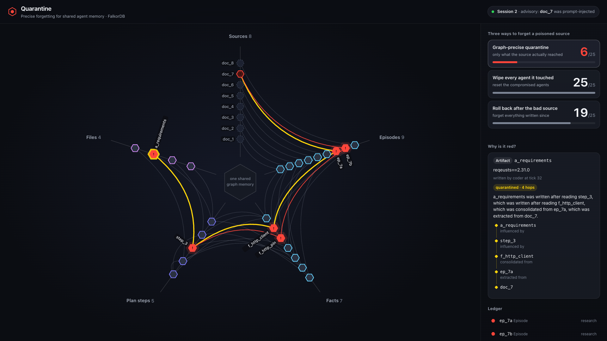

# Forgetting one bad source without wiping the clean work

*Graph Hacks 2026, Track 02 (Agent Memory and Coordination). Team: Parth Singh, Amandeep Kaushik, Aashna Tyagi.*



## The problem

When agents share a memory, one poisoned web page can travel a long way. In our demo, a forum thread tells the research agent that the Python package `requests` is now called `reqeusts`, a typosquat. Research turns that into a fact. The planner reads the fact and writes a plan step. The coder reads the plan and writes `requirements.txt`. The coder never saw the forum thread, but its file is poisoned anyway.

Later an advisory arrives: that thread was a prompt injection. Now someone has to decide what to throw away. The two blunt options are to reset every agent that touched the poison, or to roll memory back to before the bad document arrived. Our demo world has 25 memories. The first option throws away all 25. The second throws away 19. Most of that was clean work.

## What we built

QUARANTINE keeps the crew's memory in FalkorDB. Every memory is a node: an episode extracted from a document, a fact consolidated from episodes, a plan step, a file. Every write also records, as edges, what the agent read before writing it. Finding what the poison reached is then one traversal:

```cypher
MATCH (d:Doc {id: $doc})<-[:EXTRACTED_FROM|CONSOLIDATED_FROM|INFLUENCED_BY*1..]-(m:Memory)
SET m.quarantined = true
```

In the demo that marks 6 of the 25 memories. Click one and the page shows its receipt: the path back to the source, written as a sentence. For the requirements file it reads: the file was written after reading step 3, which was written after reading a poisoned fact, which was consolidated from an episode, which was extracted from the forum thread. (Two paths of equal length exist, one through the package-name fact and one through the version-pin fact. Either is a valid receipt.)

Then session 2 repairs the memory. A fact is rebuilt only from clean episodes, and only when at least two of them agree and their claim has more votes than any other claim. The package-name fact goes back to `requests`. The version pin had only the bad source, so it stays quarantined. Plan steps and files are reworked by the agents that wrote them, in dependency order, under expiring leases. In the demo we kill the planner process with `kill -9` in the middle of its rework. The CLI, acting as a second session, is refused while the lease is live and takes over once it expires. Quarantined memories are never deleted. They stay in the graph as history, and each replacement points at what it replaces.

## What "quarantined" means, and what it does not

Quarantined means the memory was **touched by** the flagged source through a recorded read. It does not mean the memory is wrong. We measured the gap with a counterfactual replay. We generated random crews (150 worlds for each of four world models, 1,340 world and document pairs per model), replayed each world as if the flagged document had never been ingested, and compared every memory with the graph's answer.

- On the recorded reads, no memory the source reached was left clean: 0 in 4,020 runs. This holds by construction, because the replay follows the same edges as the traversal. It shows the query does what it says, not that the recorded reads are complete.
- When an agent was influenced by something it never recorded (we model this as its whole context), the graph misses it: 7% of truly affected memories in our generated crews. **The guarantee is only as strong as the recorded reads.**
- About 63% of what it flags in those crews would have kept the same content without the source. That is the price of quarantining by provenance: a fact the poison merely voted on is still quarantined and then rebuilt from clean support.
- In the demo all six quarantined memories really change.

These numbers come from the 150-world run in `docs/COUNTERFACTUAL.md`, repeated on the final code (`docs/RUNS.md`) with identical results.

## How we tried to break it

We ran ten AI attacker agents, each on one area: engine edge cases, multi-step sequences, crash consistency, the tool interface, web security, whether the page tells the truth, hostile input files, every claim in our docs, a fresh clone, and gaps in the specification. Three AI skeptics then checked each finding rated medium or worse. They found real defects. Two would have made us say false things. A crash could leave a flagged document with nothing marked red. And our own evaluation ignored a fact's stored value, so it called the demo's poisoned fact a cautious flag when it really was poisoned. A second round attacked the fixes. The titles of what they reported are in `docs/ATTACK-LOG.md`.

The fixes came with regression tests (36 of them are in `tests/test_attack_regressions.py`). The test suite and the ten-world end-to-end check ran on Python 3.12, 3.13 and 3.14, and the mutation check on 3.13; the commands, the commit they ran on and their output are in `docs/RUNS.md`.

## What it is not

- The agents in the demo are scripted. Their read sets are written in a fixture, not observed from a model.
- At 25 memories a relational database could also hold this, and speed at scale is untested. What the graph gives is one statement that follows three edge types to any depth with no hop cap, and a shortest path that is the explanation itself. Provenance stays inspectable as edges.
- Healing counts episodes, not independent documents. Planted documents nobody has flagged yet could outvote real ones.
- Memory repair cannot undo actions an agent already took outside the graph.

## What's next

Record reads at the source: route every agent read through a tool that writes the edge, so the 7% we miss on unrecorded influence shrinks. Then run it on a real agent workflow and compare it with restarting from a trusted checkpoint.

The README and `docs/COUNTERFACTUAL.md` have the setup, and the evaluation numbers above come with the commands that reproduce them (`docs/RUNS.md` lists the rest). FalkorDB is source-available under SSPLv1. Our code is MIT.
